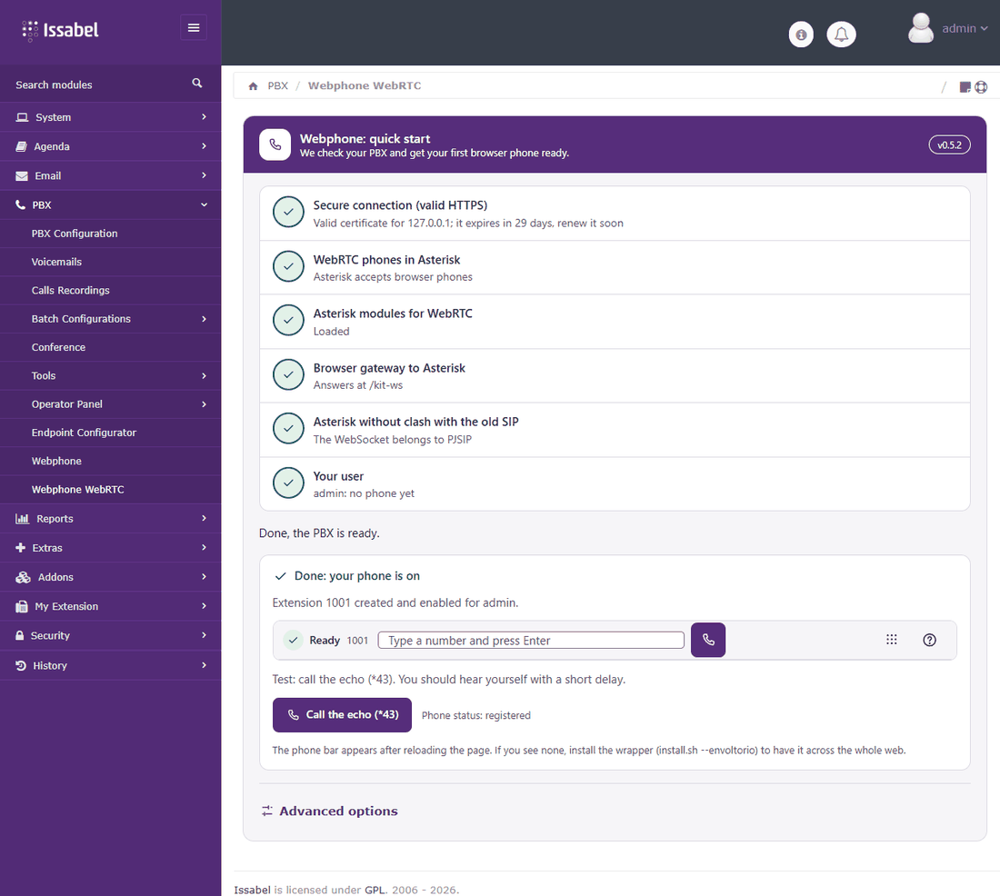
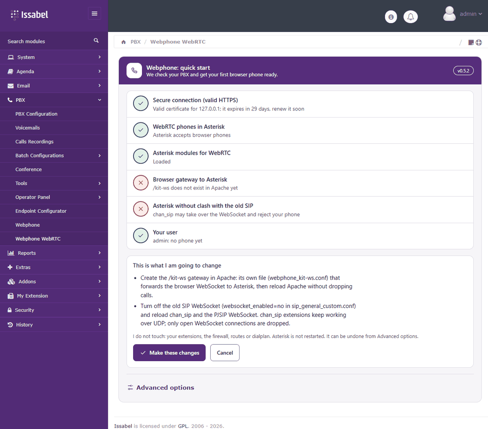
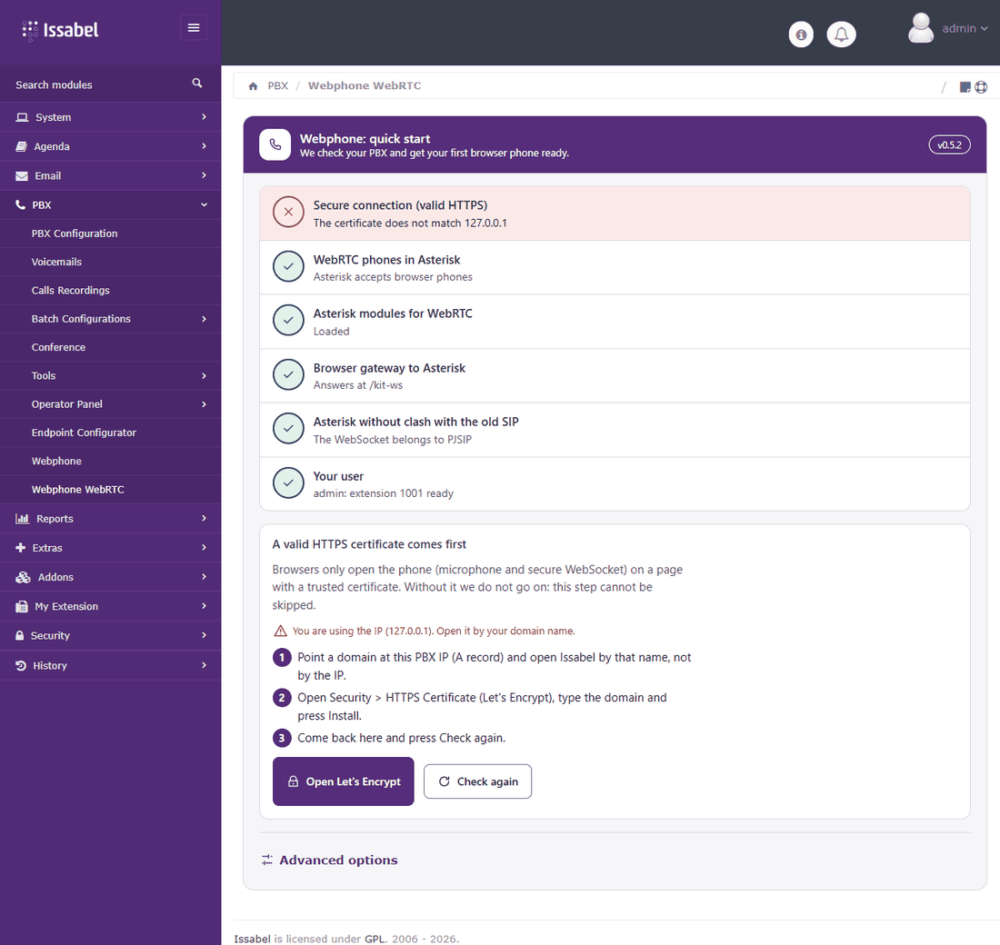

<!-- SPDX-License-Identifier: GPL-2.0-or-later -->
# Manual: tu teléfono dentro del navegador (Webphone Lite para Issabel)

**Para quién:** cualquier persona con un Issabel 5 funcionando.
**Qué vas a lograr:** un anexo WebRTC propio, registrado y con una llamada de prueba, sin softphone.
**Tiempo:** unos 10 minutos si ya tienes dominio y certificado; 25 si los haces ahora.

---

## 0. Antes de tocar nada: el candado (HTTPS)

Los navegadores **solo entregan el micrófono y el WebSocket seguro a páginas con un certificado en el que confían**. Con el certificado autofirmado de fábrica el teléfono no funciona, y el Inicio rápido **no te deja avanzar** hasta que esto esté resuelto. Necesitas:

1. Un **dominio** que apunte a la IP pública de tu servidor (registro `A`, por ejemplo `central.tu-dominio.com`).
2. Los puertos **80 y 443** abiertos (Issabel los trae abiertos; si tu VPS tiene otro firewall, ábrelos allí).

Cuando el nombre ya resuelva a tu servidor (`getent hosts central.tu-dominio.com` debe dar tu IP):

1. Entra por el nombre: `https://central.tu-dominio.com/` (acepta la advertencia esta única vez).
2. Menú **Seguridad > HTTPS Certificate (Let's Encrypt)**.
3. **Domain**: tu dominio. **Email**: tu correo. Deja **Staging** sin marcar.
4. **Install** y espera el *Output log* (debe terminar sin `ERR`). Recarga: debe verse el candado.

El módulo ajusta el `ServerName` de `/etc/httpd/conf.d/ssl.conf`, ejecuta `certbot -a webroot -w /var/www/html -i apache` y **reescribe `/etc/asterisk/keys/asterisk.pem`**, el certificado del puerto seguro 8089 de Asterisk. Para renovar, el botón **Renew** del mismo módulo. (Ojo: la renovación automática diaria de certbot renueva el de Apache pero no reescribe ese archivo; el repositorio `issabel-instalacion` trae el gancho que lo arregla.)

> Si falla: casi siempre el dominio todavía no resuelve a tu servidor o el puerto 80 no llega desde internet.

---

## 1. Instalar el módulo

En el servidor, como root:

```bash
dnf install -y git                                   # si no lo tienes
git clone https://github.com/Galcyon-Solutions/issabel-webphone-lite.git /usr/src/issabel-webphone-lite
cd /usr/src/issabel-webphone-lite
bash install.sh                                      # modulo + base + helper
bash install.sh --comprobar                          # resumen de lo instalado
```

Cierra sesión en Issabel y vuelve a entrar. El menú nuevo es **PBX > Webphone Lite**. La instalación normal incluye el **envoltorio**: una configuración propia de Apache que pone la barra del teléfono arriba de **toda** la web de Issabel (sin ella la barra solo se ve dentro de la pantalla del módulo). Si no la quieres, instala con `bash install.sh --sin-envoltorio`; para quitarla después, `bash install.sh --quitar-envoltorio`.

---

## 2. Inicio rápido: tu primer anexo

Abre **PBX > Webphone Lite**. Es una sola pantalla: arriba, una lista corta de comprobaciones en verde o rojo; abajo, lo único que puedes hacer ahora.



Las comprobaciones son solo lo esencial:

| Comprobación | Qué significa |
|---|---|
| Conexión segura (HTTPS válido) | El certificado es de confianza y corresponde al nombre con el que entraste |
| Teléfonos WebRTC en Asterisk | Asterisk acepta teléfonos del navegador (transporte `transport-wss`, que IssabelPBX trae de fábrica) |
| Módulos de Asterisk para WebRTC | Están cargados el WebSocket, el audio cifrado, etc. |
| Puerta del navegador a Asterisk | Apache reenvía el WebSocket del navegador (`/kit-ws`) a Asterisk |
| Asterisk sin choque con el SIP antiguo | `chan_sip` no se queda con el WebSocket (si lo hace, tu anexo PJSIP recibe "Wrong password" aunque la clave sea correcta) |
| Tu usuario | Si tu usuario de Issabel ya tiene teléfono, o no |

### Caso 1: todo en verde

Solo ves **Crear mi primer anexo**, con el número ya propuesto (el siguiente libre desde el 1001; puedes cambiarlo). Un clic. Se crea la extensión WebRTC con valores por defecto sensatos, se asigna a tu usuario, se activa el webphone y el teléfono se registra ahí mismo.

### Caso 2: falta algo ("Preparar")

Ves un botón **Preparar**. Al pulsarlo **no cambia nada todavía**: te lista en palabras simples qué va a hacer y qué no, por ejemplo:



- *Crear la puerta `/kit-ws` en Apache* (un archivo propio, `webphone_kit-ws.conf`, y una recarga `graceful` de Apache sin cortar llamadas).
- *Apagar el WebSocket del SIP antiguo* (`websocket_enabled=no` en `sip_general_custom.conf`, y recargar `chan_sip` y el WebSocket de PJSIP; los anexos `chan_sip` siguen funcionando por UDP y solo se cortan las conexiones WebSocket abiertas).
- *No toco*: tus extensiones, el firewall, las rutas, el dialplan; Asterisk no se reinicia.

Pulsa **Hacer estos cambios**: se aplican, se verifican y vuelves a ver la lista, ya en verde. Si hay llamadas activas, te avisa y pide confirmar. Después sigue el caso 1. Todo queda en bloques marcados `BEGIN/END webphone_kit` y se puede deshacer desde **Opciones avanzadas** o con `uninstall.sh`.

Si falta un paso que solo root puede hacer (el helper), la pantalla te muestra el comando exacto con un botón **Copiar** y **Volver a comprobar**.

### Caso 3: no hay certificado HTTPS válido



La pantalla explica qué falta y en qué orden hacerlo (dominio, módulo Let's Encrypt, volver aquí) y ofrece **Abrir Let's Encrypt**. No se puede saltar este paso. Ver la sección 0.

### Al terminar

Aparece el teléfono registrado, el estado ("Phone status: registered") y el botón **Llamar al eco (\*43)**. Púlsalo: debes oírte con un pequeño retardo. Esa llamada confirma micrófono, altavoz, registro y camino del audio.

---

## 3. Primer uso del teléfono (lo que verá cada usuario)

1. Entra a `https://central.tu-dominio.com/` con su **usuario de Issabel**. La barra del teléfono aparece arriba de todas las páginas (envoltorio).
2. El primer clic en **Llamar** abre una tarjeta que explica el permiso del micrófono. Pulsa **Activar micrófono** y, cuando el navegador pregunte, **Permitir**. Si lo negaste sin querer: candado junto a la dirección, **Micrófono: Permitir**, y **Ya lo cambié**.
3. La ayuda (**?**) tiene la **prueba de audio** en 3 pasos y los datos para soporte.

Atajos: `Alt+Mayús+A` contesta, `Alt+Mayús+H` cuelga o rechaza, `Alt+Mayús+M` silencia. Una sola pestaña por usuario.

**Consola de agente del Call Center:** con el envoltorio, el login del agente (`Agent/<n> Login`) se contesta solo. Mantén abierta la pestaña mientras estés en sesión: si la cierras o recargas, el Call Center cierra la sesión del agente (así funciona el dialer 5.1.13).

---

## 4. Opciones avanzadas

El enlace **Opciones avanzadas** (abajo de la pantalla) abre el asistente completo de siempre, para quien lo necesite: varios anexos a la vez (uno, un rango o un CSV), perfil de los anexos, activar o desactivar usuarios, ajustes (ruta WebSocket, STUN, vigencia del registro), el diagnóstico completo del servidor y del navegador, el rango de audio (RTP) y las reversas de los cambios que hizo **Preparar**. No hace falta para empezar.

---

## 5. Solución de problemas

| Síntoma | Causa más común | Qué hacer |
|---------|-----------------|-----------|
| El Inicio rápido no avanza del rojo de "Conexión segura" | Sin certificado válido o entraste por la IP | Sección 0; entra por `https://tu-dominio` |
| La barra dice **Conectando** y no pasa de ahí | El navegador no confía en el certificado o `/kit-ws` no responde | Vuelve al Inicio rápido: debe mostrar en rojo cuál es |
| Registra pero Asterisk dice **Wrong password** en el registro (`/var/log/asterisk/full`) | `chan_sip` se quedó con el WebSocket | **Preparar** (fila "SIP antiguo") |
| No pide el micrófono | Estás en `http://` o con IP y certificado inválido | Entra por `https://tu-dominio` con candado |
| Conecta pero **no se oye nada** o solo un lado | UDP del audio cerrado o IP externa mal anunciada | Abre en el firewall el UDP `10000-20000`; en nube con NAT, revisa `external_media_address`; Opciones avanzadas, paso de audio |
| Se desconecta cada ~30 s | Un WebSocket sin registro SIP lo cierra Asterisk a los 32 s | Revisa que el usuario esté **activado** y que su anexo sea WebRTC |
| Terminaste el Inicio rápido y **la barra no aparece arriba** | Mientras tu usuario no tenía teléfono, el envoltorio recibió un 403 y se apagó solo con la cookie `wp_nowrap` (10 minutos) | Desde la versión de este arreglo el Inicio rápido borra la cookie y recarga una vez. Si usas una versión anterior: espera 10 minutos o borra la cookie `wp_nowrap` y recarga |
| `403` y barra inactiva | Usuario sin activar, sin extensión o sesión de Issabel vencida | Vuelve a entrar; si persiste, Inicio rápido |
| El instalador dice `ABORTA: ...` | Falta algo (no es Issabel, `configtest` roto...) | Lee el motivo; no se cambió nada |

Comandos útiles en el servidor:

```bash
asterisk -rx "pjsip show endpoints" | head          # ¿estan los anexos WebRTC?
asterisk -rx "pjsip show transport transport-wss"   # transporte WebSocket
asterisk -rx "http show status"                     # 8088 solo en 127.0.0.1 si usas /kit-ws
tail -f /var/log/asterisk/webphone_kit.log          # bitacora del modulo
apachectl configtest                                # siempre antes de recargar Apache
```

---

## 6. Desinstalar

```bash
cd /usr/src/issabel-webphone-lite
bash uninstall.sh --si                   # quita todo menos las extensiones creadas
bash uninstall.sh --si --quitar-anexos   # y tambien esas extensiones (y suelta el enlace de tu usuario)
```

Deja copias con secretos en `/root/respaldo-webphone-desinstalar-<fecha>/` (permisos 700): bórralas cuando ya no las necesites. Solo la barra global: `bash install.sh --quitar-envoltorio`.

---

## Qué NO cubre este manual (y debes saber)

- Se probó con Chrome; **Firefox, Safari y Edge** están por verificar con audio real.
- Usuarios detrás de NAT simétrico o con UDP bloqueado pueden necesitar un servidor **TURN** (no se instala aquí).
- Para producción con clientes: ventana de mantenimiento y una llamada real antes de avisar a los usuarios.
